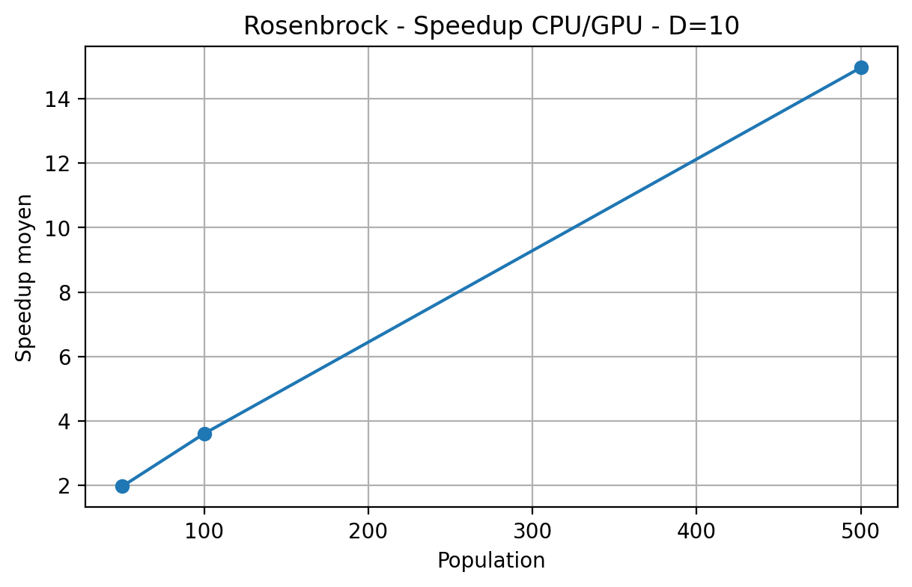
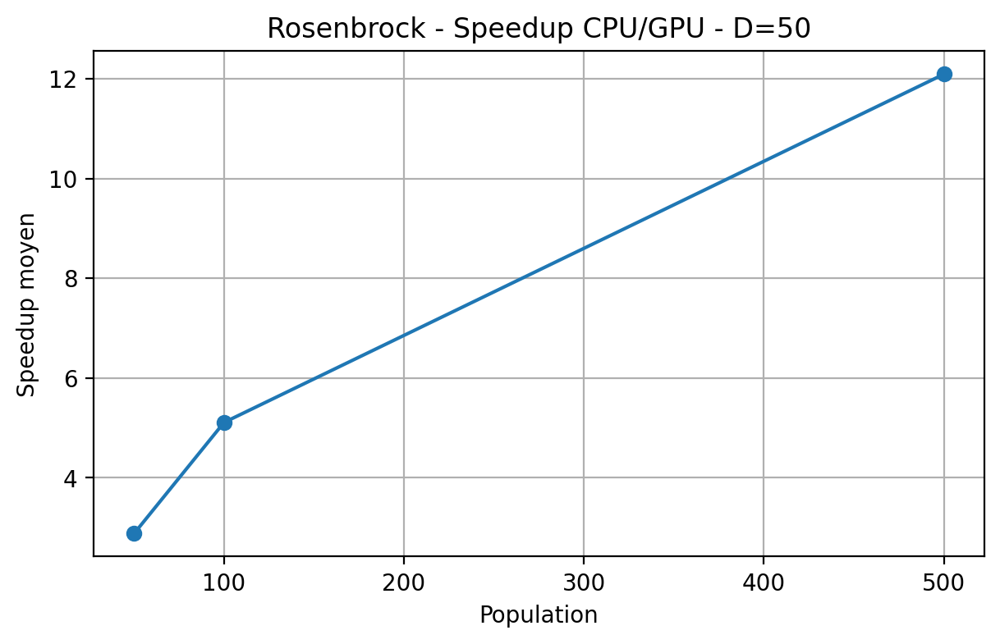
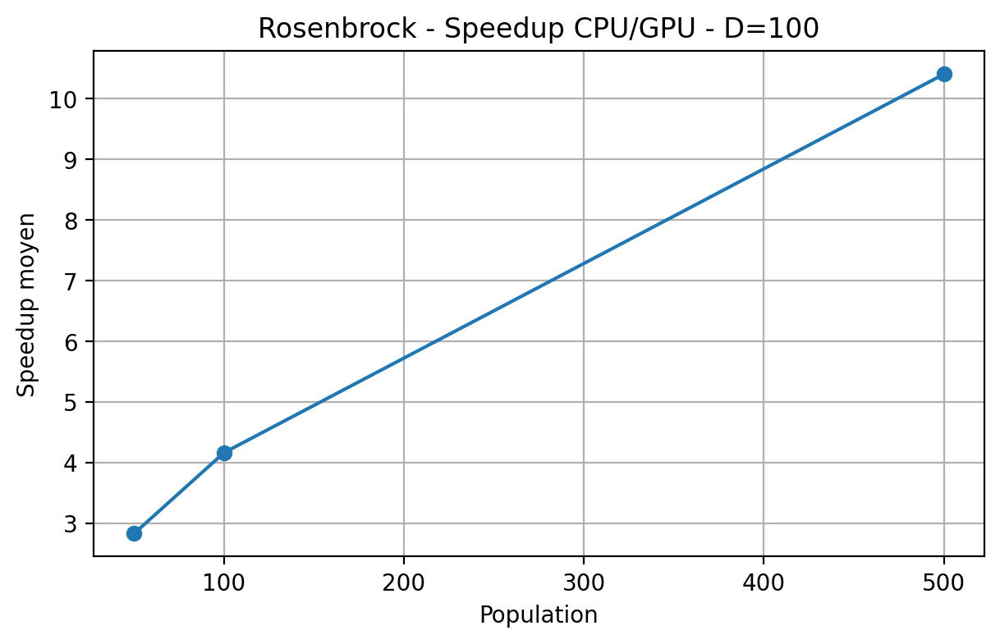
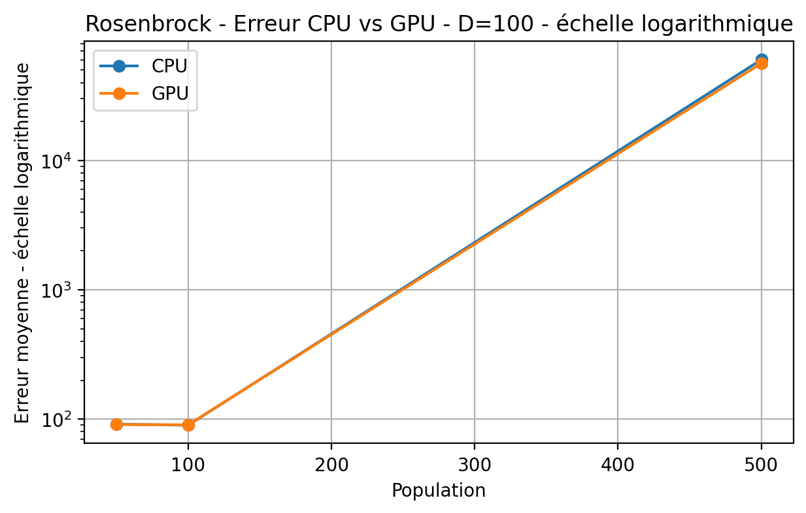

# Differential Evolution parallèle avec CUDA

Projet réalisé dans le cadre du **Master 2 Ingénierie Mathématique et Data Science** à l’Université de Haute-Alsace.

Ce projet étudie la parallélisation de l’algorithme d’optimisation **Differential Evolution (DE)** avec **NVIDIA CUDA**, ainsi que la comparaison de ses performances avec une implémentation séquentielle CPU.

L’objectif principal est d’analyser l’impact du calcul parallèle sur :

- le temps d’exécution ;
- le speedup CPU/GPU ;
- la qualité de convergence ;
- l’influence de la dimension et de la taille de population.

---

## Points clés

- Implémentation de Differential Evolution en **C++**
- Version parallèle avec **CUDA**
- Utilisation de **cuRAND** pour la génération aléatoire sur GPU
- Comparaison expérimentale **CPU / GPU**
- Analyse de quatre fonctions de benchmark
- Étude de plusieurs dimensions et tailles de population
- Validation statistique avec **Wilcoxon** et **Kruskal-Wallis**
- Analyse du compromis entre accélération GPU et convergence

---

## Algorithme

L’implémentation utilise la stratégie :

```text
DE/rand/1/bin
```

Pour chaque individu, Differential Evolution réalise :

1. **Mutation**
2. **Crossover**
3. **Évaluation**
4. **Sélection**

La mutation suit la forme :

```text
V = Xr1 + F × (Xr2 - Xr3)
```

Lors du crossover, les composantes du vecteur d’essai proviennent soit du parent, soit du vecteur mutant selon la probabilité `CR`.

Un indice `j_rand` garantit qu’au moins une composante provient du mutant.

---

## Parallélisation CUDA

La version GPU parallélise le traitement des individus de la population.

Dans le kernel de crossover, chaque thread CUDA est responsable d’un individu.

Le thread :

- parcourt les dimensions de l’individu ;
- génère les nombres aléatoires avec `cuRAND` ;
- applique la probabilité de crossover ;
- force une composante mutante avec `j_rand` ;
- applique le clamping ;
- construit le vecteur d’essai.

Cette organisation permet d’augmenter fortement les performances lorsque la charge de calcul devient importante.

---

## Protocole expérimental

Les expérimentations ont été réalisées sur quatre fonctions classiques d’optimisation :

| Fonction | Caractéristique principale |
|---|---|
| Sphere | fonction simple et convexe |
| Rosenbrock | vallée étroite et incurvée |
| Griewank | nombreux minima locaux |
| Rastrigin | fonction multimodale |

Configurations testées :

- Dimensions : `10`, `50`, `100`
- Populations : `50`, `100`, `500`
- Budget : `MaxFES = 10 000 × Dimension`
- 10 exécutions indépendantes par configuration

---

## Résultats principaux

Le speedup est défini par :

```text
Speedup = Temps CPU / Temps GPU
```

Les expérimentations montrent que l’accélération GPU augmente fortement avec la taille de population.

### Meilleur speedup observé

**≈ 16,9×**

### Exemple — Rosenbrock

Pour :

```text
Dimension = 10
Population = 500
```

le speedup obtenu est d’environ :

**≈ 15×**

---

## Visualisation des performances

### Rosenbrock — Dimension 10



### Rosenbrock — Dimension 50



### Rosenbrock — Dimension 100



---

## Analyse de la convergence

La fonction Rosenbrock est particulièrement intéressante car elle présente une **vallée étroite et incurvée**.

L’algorithme doit donc :

- localiser cette vallée ;
- progresser le long de celle-ci ;
- atteindre précisément l’optimum global.

Dans notre formulation :

```text
x* = (0, ..., 0)
f(x*) = 0
```

Le graphique suivant illustre l’erreur obtenue pour une dimension élevée :



---

## Impact de la taille de population

Une population importante offre davantage de parallélisme au GPU.

Cependant, avec un budget fixe :

```text
MaxFES = 10 000 × Dimension
```

une population plus grande signifie également moins de générations.

Pour `D = 10` :

| Population | Générations approximatives |
|---:|---:|
| 50 | 1999 |
| 100 | 999 |
| 500 | 199 |

Cela montre un compromis important entre :

**parallélisme, exploration et convergence.**

---

## Analyse statistique

Les performances CPU et GPU ont été comparées avec le **test de Wilcoxon signed-rank**.

Le seuil utilisé est :

```text
α = 0,05
```

- `p < 0,05` : différence statistiquement significative
- `p ≥ 0,05` : aucune différence significative détectée

Pour Rosenbrock, une seule configuration sur neuf présente une différence statistiquement significative.

Globalement, les versions CPU et GPU présentent donc une **qualité d’optimisation comparable**.

Le test de **Kruskal-Wallis** a également été utilisé afin d’étudier l’influence de la taille de population.

---

## Technologies

`C++` · `CUDA` · `cuRAND` · `GPU Computing` · `Differential Evolution` · `Numerical Optimization` · `Statistical Analysis` · `Jupyter Notebook`

---

## Ma contribution

Projet réalisé en équipe.

Mes principales contributions ont été :

- implémentation de la version séquentielle CPU de Differential Evolution ;
- développement du kernel CUDA de crossover ;
- gestion de `CR` et de `j_rand` ;
- gestion des contraintes avec clamping ;
- étude de la fonction Rosenbrock ;
- comparaison CPU/GPU ;
- analyse du speedup ;
- interprétation du test de Wilcoxon ;
- contribution à l’architecture CPU/GPU ;
- contribution à la documentation et à la présentation du projet.

---

## Structure du dépôt

```text
parallel-differential-evolution-cuda/
│
├── de/
│   ├── main.cpp
│   ├── kernel.cpp
│   ├── kernel.cu
│   ├── kernel.h
│   └── CudaDE.ipynb
│
├── results/
│   └── de/
│       ├── campagne_F1_final.csv
│       ├── campagne_F2_final.csv
│       ├── campagne_F3_final.csv
│       ├── campagne_F4_final.csv
│       ├── sphere_summary.csv
│       ├── rosenbrock_summary.csv
│       ├── griewank_summary.csv
│       ├── rastrigin_summary.csv
│       ├── speedup_final.csv
│       └── wilcoxon_*.csv
│
├── figures/
│   ├── Rosenbrock_speedup_D10.png
│   ├── Rosenbrock_speedup_D50.png
│   ├── Rosenbrock_speedup_D100.png
│   └── Rosenbrock_erreur_log_D100.png
│
└── README.md
```

---

## Compétences développées

Ce projet m’a permis d’approfondir des compétences à l’intersection de la **Data Science, de l’optimisation et du calcul haute performance** :

- programmation parallèle ;
- optimisation numérique ;
- expérimentation reproductible ;
- analyse statistique ;
- benchmarking ;
- visualisation de résultats ;
- analyse des performances ;
- comparaison d’algorithmes.

Ces compétences sont directement applicables à des problématiques de **Data Science, Machine Learning, optimisation et calcul intensif**.
